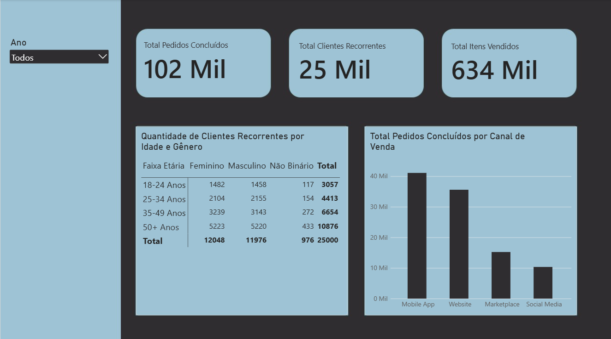

# Análise de Retenção e Performance (E-commerce Global)

Este projeto investiga uma base de operações de e-commerce global com o objetivo de mapear o perfil de retenção dos consumidores, o desempenho dos canais de aquisição e a qualidade real das conversões.

A análise foi estruturada para responder a três perguntas principais de negócio:
- Qual o volume real de pedidos concluídos e itens vendidos após filtrar gargalos operacionais?
- Qual perfil demográfico (faixa etária e gênero) sustenta a base de clientes recorrentes?
- Qual canal de venda concentra a maior taxa de conversão efetiva?

## Recursos Técnicos e Regras Implementadas

- **Power Query:** Limpeza de colunas redundantes, tratamento de valores ausentes, ajuste de tipagem e tradução dos valores da coluna `gender` (`Feminino`, `Masculino` e `Não Binário`) para padronizar a leitura em português.
- **Coluna Calculada (`SWITCH`):** Criação da segmentação de `Faixa Etária` na tabela `DimCliente`.
- **DAX (`CALCULATE`, `COUNTROWS`, `DISTINCTCOUNT`, `SUM`):** Construção de medidas filtradas por pedidos concluídos e pagos (`completed` + `paid`), além de medida auxiliar de auditoria (`Validação Recorrentes Incorretos`) para checar inconsistências na flag `is_repeat_customer`.
- **Power BI e Git:** Estruturação visual na página **Performance e Retenção** com filtro suspenso de ano, e versionamento do projeto no GitHub.

## Modelagem e Granularidade

Para manter o modelo escalável e evitar ambiguidade nos cálculos, os dados foram organizados em um **Star Schema** multi-fato:

- **Fatos:** `FatoPedidos` (granularidade de 1 linha por pedido) e `FatoItensPedidos` (granularidade de 1 linha por item do pedido).
- **Dimensões:** `DimCliente` e `DimProdutos`.
- **Governança:** Criação da tabela dedicada `_Medidas` para isolar os indicadores DAX e manter a rastreabilidade das regras de negócio.

## ETL e Validação de Dados

A preparação dos dados combinou tratamentos no **Power Query** (remoção de colunas redundantes, tratamento de valores ausentes, ajuste de tipagem e tradução dos valores de `gender` para `Feminino`, `Masculino` e `Não Binário`) com regras de segmentação na modelagem, como a criação da coluna de `Faixa Etária` na `DimCliente` utilizando `SWITCH`.

### Auditoria antes e depois (36k vs. 25k)
Durante a Análise Exploratória (EDA), criei uma medida auxiliar de auditoria (`Validação Recorrentes Incorretos`) para testar se a flag original `is_repeat_customer` correspondia apenas a pedidos finalizados e pagos.

- **Antes da validação:** A flag marcava **~36 mil registros** como clientes recorrentes, mas englobava pedidos cancelados, falhos ou com pagamento pendente (~11 mil registros inconsistentes).
- **Regra aplicada:** Na análise final, priorizei considerar como recorrentes apenas os clientes que obtiveram sucesso total na transação (`completed` + `paid`).
- **Depois da validação:** O número real de clientes recorrentes foi ajustado para **25 mil**, garantindo que os indicadores refletissem apenas receita efetiva.

## Principais Descobertas e Impacto de Negócio

- **O segmento 50+ anos é o motor de retenção:** Ao cruzar clientes recorrentes por faixa etária e gênero, o público **50+ anos** lidera com folga tanto a recorrência quanto o volume de pedidos concluídos. Além disso, há uma paridade quase simétrica entre mulheres (5.223) e homens (5.220) nessa faixa, mostrando que o mix de produtos atrai ambos os gêneros de forma homogênea.
- **Alta conversão no Mobile App:** Na comparação entre canais (`sales_channel`), o aplicativo móvel lidera isoladamente o volume de pedidos concluídos e pagos. Isso confirma que a jornada mobile apresenta forte aderência dos usuários e deve ser o canal prioritário para investimentos em campanhas de *retargeting* e fidelização.
- **Gargalo operacional no funil de recompra:** A diferença de 11 mil registros entre tentativas de compra marcadas na coluna `is_repeat_customer` bruta e pedidos efetivamente pagos e entregues aponta para um possível atrito crítico no fluxo de checkout ou durante o processamento de pagamentos, travando receita líquida de clientes que já demonstram intenção de retorno.

### Limitações da Base
Embora o conjunto de dados contenha colunas financeiras como custo unitário, a base não dispõe de um dicionário de dados oficial que especifique as regras de composição desses valores. Para evitar suposições, a análise foi direcionada estritamente para métricas operacionais de alta confiabilidade (volume de pedidos concluídos, itens vendidos e recorrência de clientes), sem cálculo de lucratividade líquida.

## Dashboard

A página **Performance e Retenção** consolida os KPIs validados, filtro temporal por ano, matriz demográfica de recorrência e comparativo por canal:

## Estrutura do Repositório

- `assets/background/` --- Layout base utilizado no plano de fundo do painel.
- `assets/img/` --- Captura de tela do relatório finalizado.
- `data/` --- Conjunto de dados brutos utilizados na análise.
- `ecommerce_performance_retencao.pbix` --- Arquivo do Power BI com ETL, modelagem e visuais.